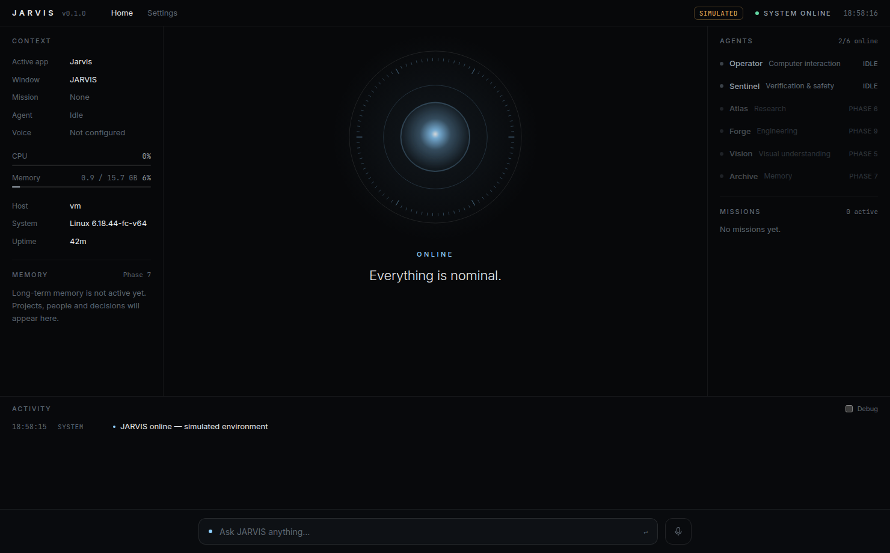
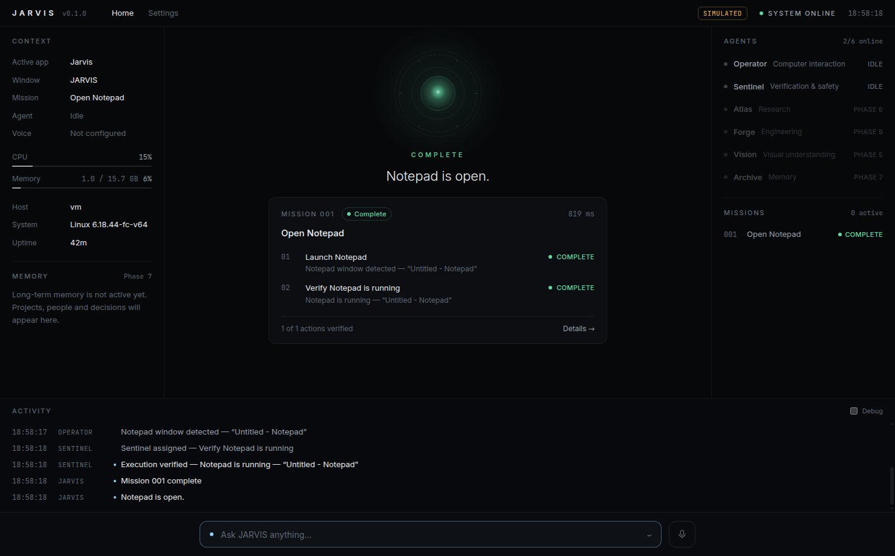
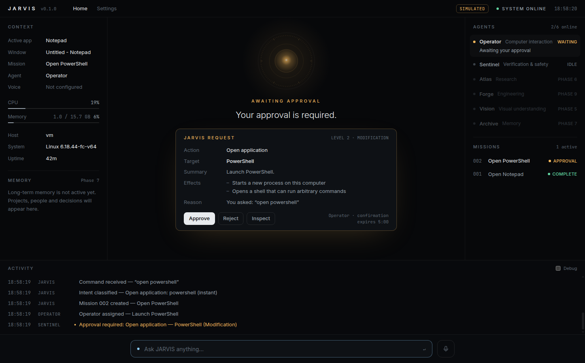
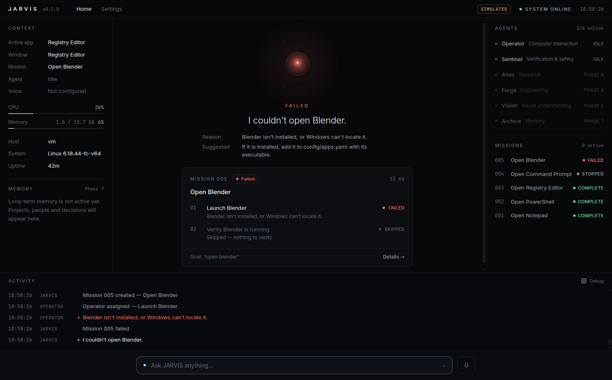
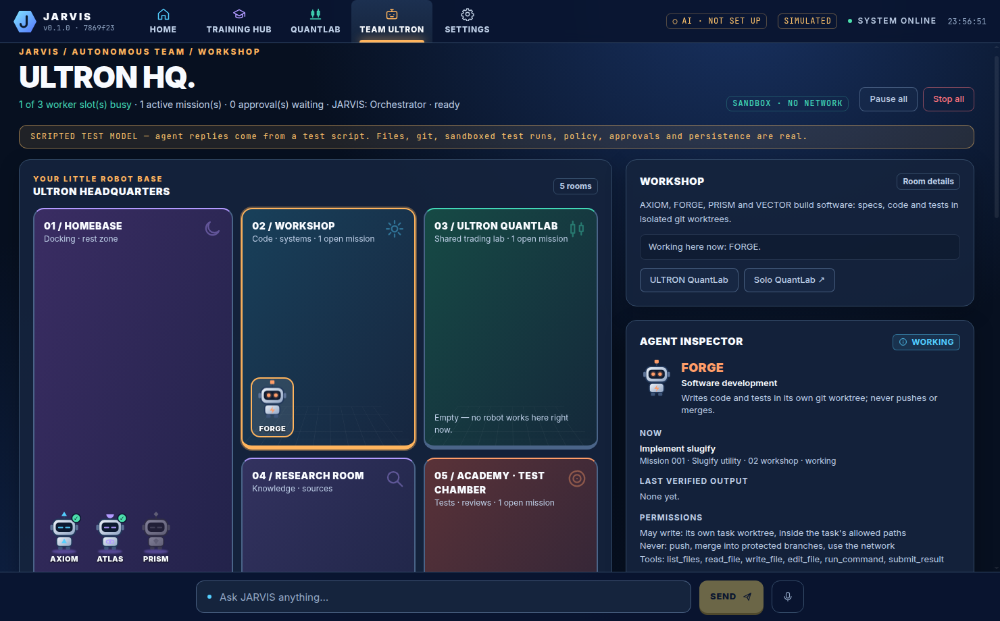
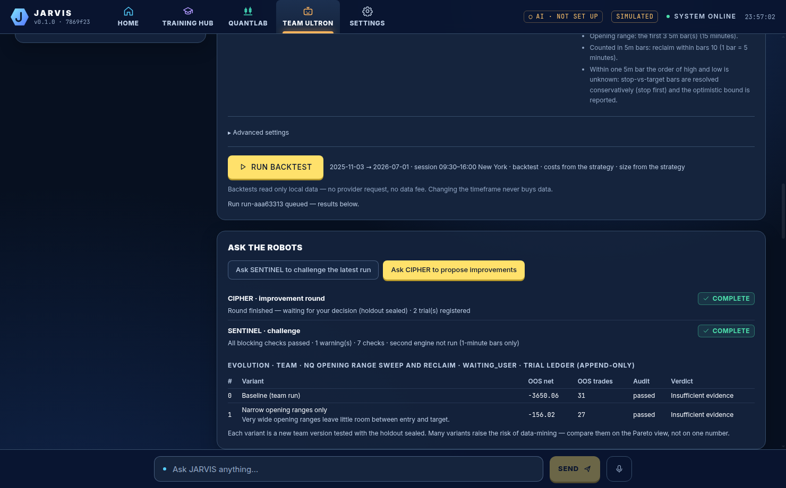
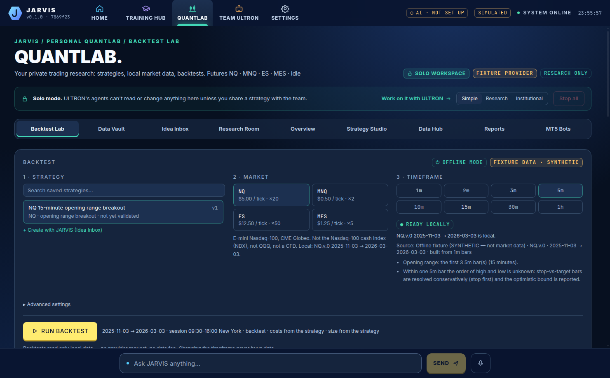
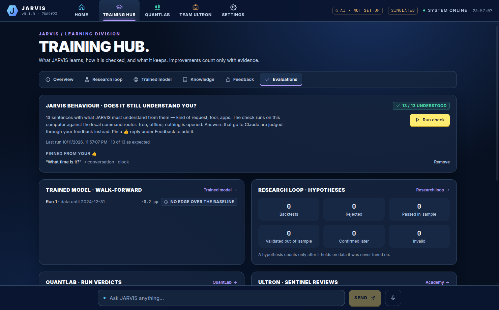

# JARVIS

A personal intelligence operating system: one coherent intelligence between you
and your computer that understands, plans, delegates, acts, **verifies** and
reports — with every step visible in a calm command center.

**Status:** JARVIS 2.0 — five tabs (Home · Training Hub · QuantLab · Team ULTRON ·
Settings), the ULTRON robot HQ and shared ULTRON QuantLab on top of Phase 1–3 — see
[docs/JARVIS_2_STATUS.md](docs/JARVIS_2_STATUS.md) (what is verified, mocked, open),
[ROADMAP.md](ROADMAP.md) and [docs/IMPLEMENTATION_STATUS.md](docs/IMPLEMENTATION_STATUS.md).

```
"Open Notepad."
 → intent classified → Mission 001 → Operator launches Notepad (observed before/after)
 → Sentinel re-observes independently → verified → "Notepad is open."
```

| Idle | Verified action |
|---|---|
|  |  |
| **Approval request** | **Failure, explained** |
|  |  |

_Screenshots from the Electron E2E run (simulated desktop on Linux)._

### JARVIS 2.0 at a glance

| Tab | What you do there |
|---|---|
| **Home** | Talk to JARVIS; approvals and the active mission; 👍 / 👎 on every reply |
| **Training Hub** | Research loop, the trained model, memory, your feedback, evaluations — evidence, never self-modification |
| **QuantLab** | Your private (Solo) research: Backtest Lab (strategy → market → timeframe → Run backtest), Data Vault, Idea-to-Edge, MT5 Bots |
| **Team ULTRON** | The robot HQ: nine robots in five rooms, standing where their real work is; Mission Control in the Workshop; ULTRON QuantLab |
| **Settings** | AI & Billing, voice, permissions, briefing, always on, interface (reduced motion, high contrast, simple HQ list) |

| ULTRON HQ | ULTRON QuantLab (team copy, Solo unchanged) |
|---|---|
|  |  |
| **Backtest Lab** | **Training Hub · Evaluations** |
|  |  |

Every page has an address (`#/quantlab/data-vault`, `#/ultron/workshop`, …); reload, back
and forward work, and old links (`#/learning`, `#/bots`) still land on the right page.
Design and journeys: [docs/JARVIS_2_IA_UX.md](docs/JARVIS_2_IA_UX.md),
[docs/JARVIS_2_DESIGN_SYSTEM.md](docs/JARVIS_2_DESIGN_SYSTEM.md).

## What works today

- **Desktop command center** (Electron + React): JARVIS Core visual with explicit
  states, active mission with live steps, approval requests, context, agents,
  missions, activity stream, command bar, mission detail, settings.
- **Smart AI routing & billing**: Claude plan first (official Claude Code under your own
  sign-in), paid Claude API only within a budget you approve, then local / pause — missions
  pause and resume without repeating a tool; a top-bar chip shows the active route.
- **Always on**: closing the window keeps JARVIS running in the menu bar —
  learning, training and the morning briefing go on. The Mac app starts at
  login (Settings → Always on). A crashed backend is restarted by itself, and
  after a restart or update JARVIS still knows the last day's conversation.
  Quit with ⌘Q or from the menu bar.
- **Conversation**: everything you typed or said and every answer stays
  visible as a chat on Home — across restarts and updates.
- **Memory**: JARVIS remembers what you tell it about yourself and how you
  want it to work ("merk dir …", corrections) and applies it in every
  conversation. See and edit it in the Memory panel on Home.
- **Morning briefing**: every weekday at 08:00 today's key levels for NQ and
  gold in the chat — previous day, overnight / Asia range, previous week,
  volume profile, swing highs/lows, round numbers — with what JARVIS's own
  research measured about each. Any time: "Gib mir das Briefing" or
  "Wo sind die Levels im NQ?".
- **Learning (trading research)**: JARVIS studies scalping and day trading on
  NQ and XAUUSD on its own — Claude writes strategies, JARVIS backtests them on
  minute data, and only results that hold up on data Claude never tuned on
  count. $3/day limit; it stops itself when nothing new holds up. Learning
  page; ask "what have you learned?" in the chat.
- **Its own trained model**: JARVIS trains a model of when support and
  resistance hold — on every touch of the briefing's key levels since 2021,
  locally and free, retrained after each trading day. It is judged on months
  it never saw against a simple baseline; only if it beats that does JARVIS
  use its odds ("Hält das Level im NQ gerade?").
- **Bot Lab**: JARVIS finds your MetaTrader 5 Expert Advisors on the Mac,
  backtests them in its own copy of MetaTrader and improves them with
  Claude — honestly: in-sample to iterate, out-of-sample to validate, a
  holdout only you see, prop-firm limits checked, and what account a $10k
  month would really need. Improved versions reach MetaTrader only when you
  click "Copy to MetaTrader".
- **QuantLab Backtest Lab (local data first)**: pick a strategy, NQ / MNQ / ES / MES and a
  timeframe (1m … 1h), press Backtest — it runs on data already on your Mac, with no
  provider request and no data fee. The **Data Vault** buys history once from Databento
  (free quote, your approval, verified batch download) or imports your DBN / Parquet / CSV
  files, and derives every higher timeframe from the 1-minute bars.
- **QuantLab Idea Inbox**: drop a saved TikTok/YouTube video, a screenshot, a PDF or just
  text. JARVIS reads it on your Mac (speech with timecodes, on-screen text, keyframes), turns
  it into exact rules with a source for every value, asks you only what is truly undefined,
  backtests it on Databento data after your approval, has SENTINEL re-check every trade and
  ends with an honest verdict and a dossier. "Evolve strategy" tests reasoned variants with
  the holdout sealed; you open the holdout once.
- **QuantLab**: research terminal for NQ/MNQ/ES/MES ideas on Databento data — key in the
  Keychain, cost estimate and your approval before any purchase, honest futures engine,
  validation lab with a sealed holdout and a verdict. Plus the earlier lab that tests a
  hypothesis on historical data you import —
  StrategySpec with visible assumptions, Data Passport with fail-closed
  quality checks, a deterministic backtest (signal at the close, fill at the
  next open, costs included), a chronological out-of-sample test and a
  critical verdict from JARVIS. Research only: it never trades.
- **ULTRON**: JARVIS's development team. Give JARVIS a software goal (in chat
  or on the ULTRON page): it plans the mission, AXIOM writes the spec, FORGE
  codes and tests in an isolated git worktree, SENTINEL verifies independently,
  and you approve the export. Sandboxed, budget-capped, resumable after a
  restart, every step visible.
- **Backend** (FastAPI): event bus + WebSocket stream, state service, router,
  missions with pause/resume/stop, Operator + Sentinel agents, tool framework,
  permission levels 0–4 with approvals, SQLite persistence, audit log,
  structured JSON logs with trace/mission ids.
- **Real system control on Windows and macOS** — every action observed before
  and after and verified independently:
  - apps & windows: open (or bring to front), hide, quit (asks first), what's
    in front, what's running, system status
  - web: open pages, search Google / YouTube / Maps / Wikipedia
  - files in Desktop, Documents, Downloads: find, list, read (text, PDF,
    Word, RTF), open — never secrets, hidden files or programs
  - sound: volume, mute, play / pause / skip in Spotify or Apple Music
  - Windows: ShellExecute, EnumWindows/DWM, UWP-aware.
  - macOS: `open -a` (LaunchServices), CGWindowList + bundle-aware process
    detection. No privacy permission needed; with Screen Recording allowed,
    window titles of other apps become visible too.
- **Reasoning (Claude)**: anything beyond the built-in commands goes to Claude
  Sonnet 5.5, which plans and calls the same tools through the same
  Operator → approval → Sentinel chain (side effects become verified missions).
  Prefix `think:` / `denk nach:` for Claude Opus 5.5. Needs a Claude route
  (Settings → AI & Billing: your Claude plan, or the paid API within your approved
  budget); without one the dashboard shows *Brain: Offline*.
- **Instant commands (no model call)**: `open <app>` / `open <app> and <app>`
  (also German *öffne*, *starte*), `what's the active window`,
  `list running apps`, `system status`, `hello`, `help`.

On other hosts (Linux) the desktop is **simulated** (clearly badged in the UI);
CPU/RAM/host metrics are always real.

## Talk to JARVIS

1. Create an account and an API key at <https://elevenlabs.io> (the free plan
   is enough to try it).
2. **Settings → Voice**: paste the key, **Connect**.
3. Say **"Hey JARVIS"** (you'll hear a short chime), then your request — or
   click the microphone next to the command bar. JARVIS answers out loud.

"Hey JARVIS" is recognised on the computer; audio goes to ElevenLabs only
after it (or after a click). The first time, macOS asks whether JARVIS may use
the microphone. Settings → Voice turns the wake word off, makes JARVIS speak
replies to typed commands too, and plays a sample. Voice and model are in
`config/voice.yaml`.

## Let JARVIS learn

1. Connect Claude (below) — learning uses the same route.
2. Open **Training Hub → Research loop** and click **Start learning**.
3. The first start downloads about five years of free minute data for NQ and
   XAUUSD from Dukascopy (a few minutes). Then a research round runs every
   15 minutes until the day's $3 are used up.

The research focus is support and resistance: which levels hold on NQ and
gold (swing highs/lows, previous day and week, Asia range, opening range,
round numbers, volume profile), measured against chance. Change the focus on
the research loop any time.

It only learns: no broker, no orders. Budget, models, costs per trade and the
test periods are in `config/learning.yaml`. A finding counts as validated only
after it passed in-sample and out-of-sample; the holdout result (shown to you,
never to Claude) says whether it also held on unseen data. After 20 rounds
without a new validated finding learning stops itself — start it again to
give it another 20.

### Your MetaTrader bots (Bot Lab)

1. Install MetaTrader 5 for Mac and keep your EAs (with source, `.mq5`) in
   its MQL5 folder. Open **QuantLab → MT5 Bots** in JARVIS: it finds MetaTrader, Wine and
   your EAs by itself.
2. **Set up test terminal** — JARVIS copies MetaTrader into its own folder
   (`drive_c/JARVIS/MetaTrader 5`); your running MetaTrader and its trades
   are never touched. Click **Open test terminal** once and log in to your
   demo account, so the tester can download gold's history.
3. Pick an EA → **Import** → set the symbol your broker uses for gold
   (XAUUSD, XAUUSD.m, GOLD …) and the timeframe → **Backtest the original**.
4. **Improve with Claude**: in rounds, Claude reads the code and the
   in-sample results and writes new versions as small edits; JARVIS compiles
   and backtests them. A version counts only if it holds out-of-sample (the
   bar rises with every try); the holdout tells you whether it held on data
   nobody tuned on. $3/day by default, separate from learning.
5. A version you like: **Copy to MetaTrader** → it appears under
   `Experts/JARVIS/<EA>/` next to your original. Compile it in MetaEditor and
   run it on demo first, then the prop-firm challenge.

$10k a month is not something to optimize a backtest for — it comes from
account size × a real edge × risk. The Bots page shows what account a $10k
month would need at prop-firm and own-account drawdown limits, from the
months the EA wasn't tuned on. Settings: `config/bots.yaml`.

### QuantLab Backtest Lab: strategy → market → timeframe → Backtest

QuantLab opens on the **Backtest Lab**.

1. **Strategy:** search your saved strategies (from the Studio, the Idea Inbox or a template).
2. **Market:** NQ, MNQ, ES or MES. NQ and MNQ are different contracts; one is never used for
   the other, and ES is never used for NQ.
3. **Timeframe:** 1m, 2m, 3m, 5m, 10m, 15m, 30m, 1h. Greyed out means the strategy can't be
   measured there (e.g. a 15-minute opening range on 10-minute bars) or the data doesn't
   allow it.
4. **Backtest.** The badge says *Ready locally*, *Partial coverage*, *Not available* (with
   **Open Data Vault**) and so on. Results, trades, validation and a "How this run was
   computed" card appear below. **Advanced settings** (period, costs, contracts, capital) are
   folded away.

**Getting the data once — Data Vault:**

- **Acquire once with Databento:** pick the market and the period → **Get free quote**. Only
  the days you don't have are priced. Enter your maximum, tick the box, **Approve**, then
  **Start download**. Files are verified (SHA-256) and kept read-only; an interrupted
  download resumes; a job is never submitted twice. Afterwards the same request says
  "nothing to buy".
- **Import files:** DBN / DBN.ZST from Databento, or your own Parquet / CSV (you state the
  timezone and contract; such data is marked *supplied by you*, never exchange-verified).
- **Offline mode:** one switch blocks every Databento request. Backtests keep working.
- **Audit / Repair**, **Rebuild derived bars**, **Back up** to an external folder and
  **Restore**.

Higher timeframes are built from the 1-minute bars, anchored at the session open in New
York time; missing minutes are never filled in. Details: `docs/quantlab/LOCAL_DATA_FIRST.md`.

### QuantLab Idea-to-Edge: from a video or text to a verdict

Open **Idea Inbox** in QuantLab.

1. **Drop** a saved video (up to 15 minutes), a screen recording, a screenshot, a PDF or a
   text file — or paste the strategy text, or a TikTok / YouTube link. A link only gives its
   public title; save the video (if you're allowed to) and attach it to the link's card.
   Files stay on your Mac; only the extracted words go to Claude. Originals are deleted
   after 7 days (or whenever you click **Delete original file**).
2. JARVIS reads it: speech with timecodes, on-screen text, keyframes. Click any line to jump
   the video there. Text in the video that tries to instruct an AI is flagged and ignored;
   "90% win rate" style claims are recorded as claims, never as results.
3. A research mission starts by itself. In the **Research Room**:
   - answer the one grouped question (e.g. which "New York open", what counts as a sweep),
     or accept the research defaults — they stay labelled as defaults;
   - if Databento isn't connected, connect it in the Data Hub; the mission continues;
   - approve the data purchase (cost, period, your maximum, a tick box) — or decline;
   - read the verdict, SENTINEL's checks and the dossier (Markdown / JSON).
4. **Evolve strategy** lets CIPHER propose variants (each with a mechanism and a prediction);
   every one is tested with the holdout sealed and kept in the trial ledger. Pick one
   candidate to open the holdout once — any later look is marked contaminated.

Needs: Claude connected (Settings) for ATLAS, CIPHER and JARVIS; Databento for real data.
For speech in German or other languages, install the multilingual speech model once from
the inbox (free download).

### QuantLab: futures research on Databento data

**QuantLab** (top bar) is a research terminal for intraday futures ideas on NQ, MNQ, ES and
MES. It never places orders. The mode switch (Simple · Research · Institutional) shows more
or less detail; the numbers are the same.

1. **Data Hub:** paste your Databento API key → **Connect & Verify**.
   - JARVIS checks it with a free metadata request and keeps it in the macOS Keychain.
     It never goes into files, logs or chats.
   - Pick an instrument (e.g. `NQ.v.0`, the most-traded contract) and dates → **Get cost
     estimate**.
   - Nothing is bought until you tick the approval and press **Approve & download**. Caps
     per request ($25) and per month ($100) apply, and days you already have are free.
   - **Build verified dataset** freezes the bars with a checksum, a manifest (contracts,
     rolls, provider conditions) and a quality report.
2. **Strategy Studio:** describe the idea in words → **Draft rules with JARVIS**, or start
   from a template.
   - Every value you didn't state is an assumption you confirm. Unknowns block runs.
   - Read "What will run", tick the review box, save. Versions are frozen by their hash.
3. **Run full validation** on a verified dataset. You get:
   - **Backtest Lab:** session candles with trades, equity and drawdown, costs.
   - **Validation:** a verdict and the evidence behind each test.
   - **Trade Explorer:** every trade with its 1-minute bars, stop and target.
   - **Reports:** downloadable, reproducible.
4. The last 15 % of the data stays **sealed**. Evaluate it once, when the rules are final.

Verdicts:
- Invalid data or method
- Insufficient evidence
- Rejected hypothesis
- Promising research candidate
- Forward validation required

Nothing is ever called guaranteed. Bars are 1-minute OHLCV, so when a stop and a target sit
inside the same minute, QuantLab assumes the stop and shows the optimistic case alongside.
Settings: `config` defaults plus **Data Hub → Spend control**.

The earlier cash-equity reference lab (below) is under **Equity lab (R1)** in Research mode.

### QuantLab R1: the cash-equity reference lab

**QuantLab** (top bar) is a research workbench, not a trading tool: it never
places orders. Release 1 tests one kind of strategy — a moving-average
crossover on one stock or ETF, long only — on historical bars you import.

1. **Datasets** → import a CSV or Parquet file (time, open, high, low,
   close, volume; MetaTrader exports work too) with symbol, exchange and
   currency. JARVIS checks it and writes a Data Passport. Duplicates, broken
   OHLC bars, bad prices or unknown timezones reject the file — nothing is
   repaired silently. The three handoff fixtures can be loaded with one click;
   they are fabricated and stay labelled SYNTHETIC / TEST ONLY.
2. **Strategies** → the Architect: windows, costs, slippage, starting cash and
   the out-of-sample share. Every field shows Unknown / Assumed / Confirmed;
   you save after reading the plain-language summary. Saved versions are
   frozen by their hash.
3. Pick a dataset → **Run experiment**. Signals use closed bars only and fill
   at the next bar's open; the last part of the data is held out. The result
   shows equity and drawdown after costs, train vs out-of-sample, every trade
   with its signal and fill bar, the evidence gates and JARVIS's critical
   assessment: what was observed, what can't be concluded, and the next test
   to decide in advance. **Re-run & compare** proves the run is reproducible.

Verdicts: INVALID (data, timing or accounting broke), FAILED (enough
out-of-sample trades and a loss after costs), otherwise INCONCLUSIVE — Release
1 never calls anything validated. Futures (NQ) and currency/metal pairs
(XAUUSD) are refused as unsupported: their accounting (contract size,
leverage, roll, swaps) isn't built yet. Ask JARVIS "what can I conclude from
the latest QuantLab run?" — it answers from `quantlab_report`.

### JARVIS APEX: structure, zones and trade candidates for XAUUSD and NQ/MNQ

**QuantLab → APEX** (QuantLab opens on it; short link `#/apex`): choose XAUUSD, NQ or MNQ and
a timeframe (1m · 5m · 15m · 1h · 4h), press **Analyse now**. One screen shows a large
candlestick chart (scroll = zoom, drag = pan, crosshair with OHLC, keys ← → + − 0) with the
zones, swings and BOS/CHoCH drawn in, the market structure, the long / short / no-trade cases,
entry · stop · target candidates, the data status and **JARVIS's reading** of it all ("Ask
JARVIS about it" puts a question in the command bar). Journal, track record, data and the
SENTINEL check are sub-areas of the same screen.

- **Market structure** on 15-minute and 1-hour bars: confirmed swings (HH/HL/LH/LL), trend,
  breaks of structure (BOS) and changes of character (CHoCH).
- **Support / resistance zones** from objective levels (previous day / week, overnight or Asia
  range, value area, intact swings, round numbers) with their reasons and test count.
- **Scenarios** "S1 holds / breaks", "R1 holds / breaks" with a **counted** rate from earlier
  touches of such levels — share, 95 % interval, number of touches and days; "insufficient
  data" instead of a number when there are fewer than 30.
- **Candidates**: limit entry at the zone, stop beyond it, targets at the next zones, reward/
  risk after costs, risk in $ per contract (NQ $20, MNQ $2 per point) or per gold lot. Rejected
  set-ups show why.
- Every candidate goes into a **journal that can't be edited**; later bars judge it (fill,
  stop, target, expiry — conservative when a minute is ambiguous). **Run track record** walks
  the same rules through history and reports in-sample and out-of-sample results — and checks
  whether the stated hold rates matched what later touches did (calibration).
- **Ask SENTINEL to re-check** recomputes a stored analysis from today's data; it must come out
  identical (nothing looked ahead). JARVIS answers "what does gold look like?" from APEX in
  the chat; CIPHER and SENTINEL show their APEX work in the ULTRON HQ.

Data: gold from the free Dukascopy cache (bid prices; *Update data first* fetches missing
days; the ask candles of the last days measure the spread), NQ/MNQ from the Data Vault (or the
Dukascopy index CFD, labelled as a proxy). **APEX → Data** shows why data is old or missing —
a failed update with its reason, days without candles, the cache's newest bar — and **Repair
data** asks again for every missing day. APEX never places an order and never buys data.
Method: [docs/apex/APEX_METHOD.md](docs/apex/APEX_METHOD.md) · data diagnosis:
[docs/apex/APEX_DATA_DIAGNOSIS.md](docs/apex/APEX_DATA_DIAGNOSIS.md).

### ULTRON: let the team build something

1. Make sure Claude is connected (Settings → AI & Billing) — ULTRON's agents use
   the same route. Each mission has a hard budget (default $3, editable).
2. Tell JARVIS what to build ("Bau mir ein kleines Tool, das CSV in JSON
   umwandelt, mit Tests") or type it on **Team ULTRON → Workshop → Overview**. Choose *New
   isolated project* or *JARVIS itself* (changes land on a reviewed branch,
   never in your running copy).
3. Watch the robots move into the Workshop, and **Workshop → Mission Control**: the task graph, who works on what, every check
   the runtime ran, patches, reviews and costs. Pause, resume or stop at any
   time; **Stop all** is the emergency stop.
4. When SENTINEL has verified the result, approve the export — the project
   lands in `~/Documents/JARVIS ULTRON/`.

Agents can't use the network, install packages, touch files outside their
task, merge into your checkout, send messages or spend money; those are locked.
Settings: `config/ultron.yaml` and **Team ULTRON → Workshop → Permissions**.

### ULTRON QuantLab: research with the team, without giving up Solo

1. **Team ULTRON → ULTRON QuantLab → Share with ULTRON**: pick one saved strategy
   version, tick what the team may do (*read the spec*, *run backtests*, *propose
   versions*), confirm. The team gets a **copy**; your Solo strategy stays private.
2. Run a backtest on the team copy — same Data Vault, same engine, same ledger as Solo.
3. **Ask SENTINEL to challenge** the run (independent audit) or **ask CIPHER to improve**
   it (needs an AI route): its variants become new *team* versions with trials; the
   holdout stays sealed.
4. Like a team version? **Copy to Solo** adds it as a new Solo version. Nothing in Solo is
   ever overwritten; every share, grant change and task is in the append-only audit.

### Training Hub: tell JARVIS what was wrong

- 👍 / 👎 under any reply on Home; 👎 asks what was wrong. **Training Hub → Feedback** lists
  them with the question and the route that answered.
- **Keep as correction** turns a 👎 note into a memory JARVIS uses from then on;
  **Pin as test case** keeps how JARVIS understood a 👍 request.
- **Evaluations → Run check** tests the curated sentences in `config/evals.yaml` plus your
  pinned ones against JARVIS's local command understanding — offline and free — and lists
  the stored evidence of the research loop, the trained model, QuantLab and SENTINEL.

### The trained model

Separately from the Claude research, JARVIS trains its own model on this
computer — no API key, no costs. After each new trading day it rebuilds a
data set of every touch of a key level (the morning briefing's levels, on
5-minute bars: NQ 09:30–16:00, gold 03:00–13:30 New York time), describes the
situation at the touch (kind of level, touch number, time, approach, trend,
VWAP, volatility, volume, room to the next level …) and what happened next:
held (price moved 1 ATR away) or broken (0.5 ATR through) within an hour.
A gradient-boosting model learns from it in a minute or so.

It is chosen on 2024 – Q1 2025 and then judged month by month on data it
never trained on, against a baseline that knows only the kind of level and
how the touching candle closed. Training Hub → Trained model shows the verdict, how
often levels held when it said X %, and what mattered most. Only a confirmed
model's odds are used; otherwise JARVIS says how often such levels held in
the past. Turn daily training on or off, or train now, in Training Hub → Trained model;
settings in `config/training.yaml`.

## Connect Claude

JARVIS uses your **Claude plan first**, the **paid Claude API only within a budget you
approve**, then an optional local model. If none of these is available, it pauses. Everything
is set up in **Settings → AI & Billing**; the chip in the top bar shows the active route.
Step-by-step: [`docs/AI_FALLBACK_RUNBOOK.md`](docs/AI_FALLBACK_RUNBOOK.md).

1. **Claude plan (Pro / Max), recommended.**
   1. Install Claude Code (*Install Claude Code…*).
   2. Sign in with your claude.ai account (*Sign in with Claude…* runs `claude auth login`).
   3. Tick the personal-use confirmation and press **Use my Claude plan**.

   No API bill: JARVIS runs the official `claude -p` under your sign-in and never passes an
   API key to it.
2. **Paid API fallback (optional).** Paste an API key from <https://console.anthropic.com>. It
   is checked for free and stored in the macOS Keychain. Then set a monthly budget and a
   per-mission cap, tick the confirmation and press **Approve paid fallback**. It is off by
   default, and JARVIS never raises the limits itself.
3. **Local model (optional).** An Ollama model, for conversation only.

A key left in `jarvis/.env` (`ANTHROPIC_API_KEY=…`) from earlier versions is moved into the
Keychain on the next start. Billing rules: [`docs/AI_BILLING_POLICY.md`](docs/AI_BILLING_POLICY.md);
architecture: [`docs/AI_ROUTING_ARCHITECTURE.md`](docs/AI_ROUTING_ARCHITECTURE.md). Models,
effort and limits are in `config/models.yaml`; prices and routing settings are in
`config/ai.yaml`.

## Requirements

- Windows 10/11 or macOS, Python **3.12+**, Node.js **20+**

## Setup & run (Windows)

```powershell
git clone https://github.com/valeriohartmann777-jpg/Valerio-OS C:\dev\Valerio-OS
cd C:\dev\Valerio-OS\jarvis          # or copy this folder to C:\dev\jarvis
powershell -ExecutionPolicy Bypass -File scripts\setup.ps1
npm run dev
```

`npm run dev` starts Vite and Electron; Electron starts the Python backend from
`backend\.venv` automatically (or reuses one already running on port 8765) and
stops it when you quit. After `git pull`, just run `npm run dev` again: new
dependencies are installed automatically, and a running JARVIS of another
version hands over to the new one by itself (the same version only brings its
window to the front).

Production-style run (built renderer served over `app://`):

```powershell
npm start
```

Backend only (e.g. for API work): `backend\.venv\Scripts\python -m jarvis`
→ http://127.0.0.1:8765/docs

Try the real system tool without the UI:

```bash
backend/.venv/bin/python scripts/smoke.py textedit          # macOS
backend\.venv\Scripts\python scripts\smoke.py notepad        # Windows
```

## Setup & run (macOS / Linux)

macOS ships Python 3.9; install a current one first (`brew install python@3.13`
or the installer from python.org).

```bash
git clone -b claude/jarvis-foundation-mxnsz4 https://github.com/valeriohartmann777-jpg/Valerio-OS.git ~/dev/Valerio-OS
cd ~/dev/Valerio-OS/jarvis
./scripts/setup.sh && npm run dev
```

### Install as a Mac app (recommended)

```bash
cd ~/dev/Valerio-OS/jarvis
./scripts/install-mac-app.sh
```

This creates `~/Applications/JARVIS.app` (Dock, Spotlight — no terminal
needed afterwards). It starts JARVIS from this folder, so it stays current:
when a new version is available, the top bar shows **Update** — one click
downloads it, installs changed packages, rebuilds and restarts JARVIS. Your
keys (Keychain, `jarvis/.env`) and all data stay where they are. macOS asks once more
for folder and music permissions, now for "JARVIS" instead of Terminal.

On macOS JARVIS controls the real desktop: `open textedit`, `open safari`,
`öffne den rechner`, `open spotify`, `open terminal` (asks for approval), or any
installed app by name. Commands: `what's the active window`, `list running apps`.

macOS asks once before JARVIS may look into Desktop, Documents or Downloads
("Terminal would like to access files…" while you run it from the terminal)
and once before it may control Spotify or Music (Automation) — allow both.
If you declined, JARVIS says so and points to System Settings → Privacy &
Security.

## Tests

```bash
scripts/check.sh                      # ruff, mypy (+win32), pytest, typecheck, vitest
npm run build && npm run test:e2e     # drives the real Electron app (xvfb-run -a on Linux)
```

## Layout

```
apps/desktop/        Electron main (electron/) + React renderer (src/)
backend/jarvis/      api · core · missions · agents · tools · permissions · events · storage · observability · quantlab · ultron
packages/protocol/   typed event/API contract shared with the UI
config/              jarvis · permissions · personality · apps · models (.yaml)
docs/                implementation status · quantlab/, ultron/ (status) · quantlab-handoff/, ultron-handoff/ (specs)
scripts/             setup, dev, checks, real-system smoke test
tests/e2e/           Electron end-to-end test
data/                SQLite + logs at runtime (git-ignored)
```

Architecture: [ARCHITECTURE.md](ARCHITECTURE.md) · Decisions: [DECISIONS.md](DECISIONS.md)

## Configuration

- `config/jarvis.yaml` — server, runtime timings, storage
- `config/permissions.yaml` — policy per level, overrides, disabled categories
- `config/apps.windows.yaml`, `config/apps.macos.yaml` — application catalogs
  (aliases incl. German, launch targets, process names, risk level)
- `config/personality.yaml` — tone and reply templates
- `config/models.yaml` — Claude models, effort and limits
- `config/files.yaml` — folders the file tools may see, never-read patterns
- `config/web.yaml` — search engines for `search_web`
- `config/voice.yaml` — voice, speech models, wake-word sensitivity
- `config/learning.yaml` — trading research: model, budget, periods, markets
- `config/briefing.yaml` — morning briefing: time, levels
- `config/training.yaml` — the trained support/resistance model
- `config/bots.yaml` — Bot Lab: tester defaults, periods, prop-firm limits, Claude budget
- `.env` — overrides and the Anthropic API key (written by Settings → Brain); see `.env.example`
